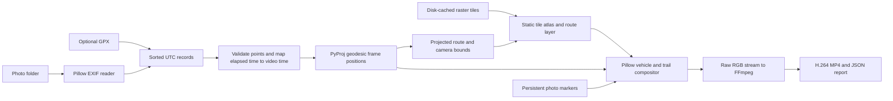

# Rendering reference

Detailed behavior of the current Python video renderer. For setup, see the [README](../README.md); for JSON settings, see the [configuration reference](configuration.md). Flag names below apply to the advanced renderer CLI.

## Stack and data flow

**Pillow**, **PyProj**, **imageio-ffmpeg**, **tqdm**, and **CairoSVG** are required. No GeoPandas/Shapely/Matplotlib dependency is necessary for a sequence of geodesic segments and raster sprites. FFmpeg is supplied by imageio-ffmpeg's wheel on supported platforms; `IMAGEIO_FFMPEG_EXE` can select a system binary.



Modules: `photo_to_gpx/video/travel_route.py` handles metadata and timing; `photo_to_gpx/video/video_map.py` handles camera planning, maps and sprites; `photo_to_gpx/video/playback.py` inserts arrival holds; `photo_to_gpx/video/speed_control.py` retimes movements against ground distance and planned camera zoom; `photo_to_gpx/video/photo_markers.py` handles image caching and circular markers; `photo_to_gpx/video/vehicle_config.py` reads raw-photo icon ranges; `photo_to_gpx/video/photos_to_video.py` connects them with a small argparse entry point.

## Interpolation and time compression

EXIF `DateTimeOriginal` is mandatory. Nested `OffsetTimeOriginal` and `SubSecTimeOriginal` are read; an explicit EXIF offset takes precedence over `--timezone`. Without an offset, a complete GPS UTC date/time is used to recover the local capture offset (including date rollover and small camera/GPS clock differences). If that is unavailable or inconsistent, the supplied IANA timezone is used (default America/New_York). Ambiguous or nonexistent daylight-saving wall times are skipped. Traveling across timezones requires correct per-photo EXIF offsets; a single fallback timezone cannot infer them. HEIC requires a separately installed/registered Pillow decoder; unsupported images are reported as skipped.

Records normalize to UTC before sorting and interpolation, including DST fold transitions, and sort by UTC time, then path for deterministic ties. Coordinate ranges and DMS values are validated. Same-time photos within 50 m retain individual photo events but share one route anchor. Same-time locations farther apart are reported as conflicts and skipped. Segments exceeding `--max-speed-kmh` (CLI default 1,200) are rejected relative to the previous accepted anchor; raise this threshold for flights. This is a conservative plausibility check, not a complete outlier reconstruction algorithm.

For each accepted pair, use [PyProj `Geod.inv` and `Geod.fwd`](https://pyproj4.github.io/pyproj/stable/api/geod.html) for WGS84 ellipsoidal distance, position, and heading. Latitude/longitude are **not** linearly interpolated. Web Mercator is used only for map alignment, not ground distances. Longitudes unwrap for continuous antimeridian rendering. Locations/geodesics beyond the raster projection's ±85.0511° coverage are rejected.

Before speed limits, the default `--timing time` maps the sleep-adjusted elapsed intervals to the chosen journey duration with one scale factor. A three-hour interval receives three times the video time of a one-hour interval after overnight adjustment, regardless of distance. Within each segment, the real timestamp advances linearly. On geodesic segments the distance fraction also advances linearly; rounded local curves are reparameterized by arc length. The speed controller then shortens or lengthens intervals when needed; intervals within the limits keep their original elapsed-time allocation. Original photo timestamps and route geometry remain intact.

By default, subtract **seven hours once per gap** only when all three conditions hold: at least seven hours of real elapsed time, physical WGS84 distance strictly above `--sleep-distance-km` (default **1,000 km**), and crossing **2 AM in the departure photo's local timezone**. Adjusted intervals are at least one second. EXIF or recovered GPS offsets define that timezone; `--timezone` applies to missing-offset and GPX inputs. Original UTC timestamps, GPS plausibility checks, and arrival pauses remain unchanged. Use `--no-sleep-adjustment` to disable this feature. Reports include `sleep_adjustments` with distance and elapsed, subtracted, and adjusted seconds. With a fixed `--duration`, sleep removal changes each segment's share of that baseline.

`--duration 90` specifies the **baseline movement portion**, before speed limits or pauses; proportional mode defaults to 90 seconds. After every segment, freeze the vehicle and timestamp for a constant wait:

- **0.4 seconds** for distances at or above `--flight-km` (default 150 km), configurable with `--long-pause`.
- **0.2 seconds** for shorter distances, configurable with `--short-pause`.

Arrival pauses are separate from speed-controlled movement. Photo arrival times include earlier holds but trigger before the pause at their own location. Set both pause parameters to zero to disable arrival pauses. At 30 FPS, these continuous-time waits are quantized to available frames; short waits typically span one or two frames.

Photo appearances are spaced at least **0.5 seconds** apart after speed retiming and existing arrival pauses. If the next movement is too short, the vehicle and map wait at the preceding photo just long enough to supply the missing time. Same-timestamp photos also appear sequentially, and the final overview waits for the last photo. Movement speed and geographic placement remain intact. Change `MIN_PHOTO_INTERVAL_SECONDS` in `photo_to_gpx/video/playback.py` to adjust the interval. The renderer rounds it up to whole frames, so low frame rates also respect the minimum. `--no-photos` skips these extra waits. Reports include `photo_intervals` with effective WGS84/rounded-path distance, actual movement time, original arrival gap, rendered gap, and added delay.

Very short real intervals can occupy less than one frame at a compressed frame rate. Photo arrivals round up to the next frame, and every accepted photo persists thereafter. Increase `--duration` to resolve short movements individually. At the end, the camera takes `--overview-seconds` (default 3) to zoom out and holds all photos for `--overview-hold` (default 5). `--popup-seconds` remains available as a minimum final overview hold (default 4); it does not expire markers.

The optional `--timing compressed` retains bounded elapsed-time compression:

```python
seconds = clamp((dt / time_scale) ** compression, min_segment, max_segment)
# defaults: time_scale=300, compression=0.5, min_segment=0.8, max_segment=6
```

This mode intentionally changes relative interval lengths to limit long gaps, but still uses elapsed time rather than distance to allocate segment durations. Its `--duration` override rescales segments and refuses segments shorter than 0.2 seconds. Min/max/compression settings are ignored by proportional mode.

`Route.at(animation_time)` returns animation seconds, UTC timestamp, latitude, longitude, heading, and segment index. Gaps above `--gap-hours` (default 6) are reported as inferred transfers. Connections do not reconstruct roads, railways, or actual activity during gaps. Local segments shorter than the flight threshold use cubic Bezier curves in an azimuthal equidistant metric projection, with tangent directions shared across adjacent segments. Control distances are bounded by `--turn-radius-m` (default 1,000 m) and 30% of neighboring segment lengths. Every photo anchor remains exact. A sampled arc-length table maintains time-based progress along each curve. Long transfers retain their WGS84 geodesics. `--turn-radius-m 0` disables local curves. The CLI's 1,200 km/h plausibility limit permits ordinary flights; `Route` itself retains the conservative 350 km/h default for callers that do not specify a limit.

## Animation speed limits

The minimum defaults to **2,000 ground metres per animation second** (`--min-speed-mps 2000`). The upper screen-speed cap is **temporarily disabled by default** (`--max-screen-speed-px 0`); use `--max-screen-speed-px 540` to restore the previous limit. These are playback speeds, separate from the real-world `--max-speed-kmh` GPS plausibility check. The floor is independent of zoom: shorten a slow moving interval until its ground speed reaches the configured minimum. A same-location photo gap collapses to one frame of stationary motion rather than a long idle period. Arrival waits and the final overview remain separate.

The ceiling depends on the planned viewport: a pixel represents more ground distance at wider zoom, permitting faster planes while limiting vehicles in a local view. Calculate it using Web Mercator displacement, viewport size, camera translation, and zoom changes, with a small safety margin. The camera pulls back early on transfers outside the city threshold, rather than chasing a fast vehicle at street-level zoom. The zoom-rate cap is also disabled by default (`--max-zoom-rate 0`): travel and camera zoom advance together instead of slowing the vehicle near departure and arrival to satisfy a camera ceiling. Set `--max-zoom-rate 1` explicitly to limit zoom changes to one doubling/halving per second; this can substantially lengthen the video and make the vehicle creep during zoom transitions. Local framing automatically widens if necessary to fit the requested floor and screen ceiling.

Limits can change the resulting video length; `--duration` is a baseline, not a fixed final runtime. Movement progress and photo triggers use the same piecewise clock, so photos still appear at their actual route anchors and fixed arrival waits stay unchanged. Set all three controls to zero to restore the original proportional clock and camera behavior:

```bash
--min-speed-mps 0 --max-screen-speed-px 0 --max-zoom-rate 0
```

If explicitly configured limits still conflict, the screen/zoom ceiling takes priority and the report counts the affected intervals. Reports include per-leg nominal/adjusted durations and ground speeds, plus frame-level measured ground speed, screen speed, and zoom rate. Limits apply during the journey; the separate final overview retains its configured transition duration.

## Caching and rendering

The default `--camera fly` plans every camera viewport before encoding. It follows the journey, pulls back early for transfers outside `--city-km` when speed controls are enabled, and zooms into the destination. Without speed controls, the flight threshold is `--flight-km` (default 150). By default, a sine-squared zoom envelope spreads the zoom across each trip while eased camera centers follow departures and arrivals; the viewport widens if necessary to keep the vehicle visible. For segments within `--city-km` (default 5), the camera stays exactly still while the vehicle remains inside a safe viewport margin. With photos enabled, that margin includes the full photo circle, shadow, timestamp label, and space for the bottom overlays. Panning starts before a new photo would be clipped. `--local-span-km` (default 4) controls local framing in projected map units. Photo geographic placement and vehicle timing remain unchanged.

Compute the union of required tiles across all camera zoom levels, then download/cache it before rendering. `--max-tiles` defaults to 1,200; when necessary, lower map zoom levels to stay within that budget. Requests use four workers. Rendering uses only cached files, with an LRU holding 128 tiles and four stitched viewport atlases; no network requests occur during encoding. Background atlases are rebuilt only when tile bounds or zoom level change. The route and trail use an independent curve sampling layer, so short turns remain rounded even when their photo times fall between video frames. Both the vehicle and the trail follow the same curves.

`--camera fixed` frames the complete route; `--camera follow` uses fixed zoom and keeps the vehicle centered under speed control; with speed controls disabled, it uses exponential center smoothing. Both share the cached tile renderer and final overview. Only the traveled trail is drawn; future route segments remain hidden.

The default provider is the public [Esri World Topographic Map service](https://services.arcgisonline.com/ArcGIS/rest/services/World_Topo_Map/MapServer). `--map-provider carto` requires `CARTO_BASEMAP_API_KEY` for uncached tiles; [CARTO requires an API key](https://www.carto.com/basemaps/apikey/) and its anonymous endpoint returns watermarked PNGs. Cache paths use separate provider namespaces under `.cache/photo-video/`. `--offline` refuses missing/corrupt tiles, while `--plain-map` provides a schematic background without geographic tiles. Full attribution is cached into a wrapped footer and remains visible at smaller resolutions.

Vehicle sprites are transparent, rotated clockwise according to projected heading, and cached by integer-degree rotation. Custom icons must face north/up. No full video frames are retained or written as PNGs: one RGB frame at a time streams to FFmpeg. One frame copy and RGB byte conversion remain.

During rendering, a `tqdm` progress bar on stderr shows completed/total frames, elapsed time, frames per second, and estimated time remaining. Progress advances after each frame is sent to FFmpeg and closes on completion or error.

Automatic encoding probes actual one-frame H.264 encodes with NVENC, QSV, and VideoToolbox, then falls back to `libx264`. An explicit `--encoder` also falls back if its probe fails. Device availability depends on the FFmpeg build and host. A failed full encode leaves any existing destination video intact.

## Photo markers

Each accepted photo appears in a **circular, center-cropped thumbnail** with a white rim, soft shadow, and small timestamp. The circle center is its exact EXIF geographic location. Images honor EXIF orientation. Every marker stays available for the rest of the video, and multiple images coexist. A marker may move outside the current viewport as the camera travels; it returns when its location comes back into view.

Photo sizes are fixed in projected map units. At the closest camera zoom anywhere in the video, each circle has a diameter of **`photo_size` × the screen width** (default `0.15`, or 288 pixels at 1920×1080). Set `"photo_size": 0.075` in `config.json` to halve that diameter; allowed values are greater than `0` and at most `1`. Zooming out by a factor of two halves the circle diameter; its shadow and label scale with it. Photo centers, sizes, and the background use the same camera transform throughout the journey and final overview. There are no screen offsets or final-layout rearrangements. The vehicle draws last.

All photos remain registered at their locations. At wide zoom levels, thumbnails can become subpixel-sized and nearby photos can overlap; rasterization uses at least one pixel without moving the geographic anchor. The overview preserves the same geographical placement and map scale rather than promising individually readable thumbnails at global zoom. Reports include each marker's latitude/longitude, projected diameter, reference camera width, and overview pixel diameter.

Nearby burst grouping remains in the report (≤30 seconds between consecutive shots, ≤50 m from the cluster anchor, ≤2 minutes overall), but every member receives its own marker. A sprite cache accommodates the persistent marker count. `--no-photos` disables overlays. `photo_display` records raw index, arrival, visible seconds, and full-opacity seconds; expiry is null. `overlay_issues` records decode failures. `arrival_pauses` records every trip and its waiting time. Photos without usable timestamp/GPS data cannot be placed on the map and remain listed in the raw index manifest.

## Vehicle configuration

Edit a project’s `vehicles.json` to select icons by raw photo index (or pass its path with the advanced `--config` flag):

```json
{
  "default_icon": "car",
  "icons": {},
  "ranges": [
    {"start": 3, "end": 5, "icon": "train"},
    {"start": 5, "end": 10, "icon": "plane"}
  ]
}
```

Indices are **1-based and inclusive**, assigned to all supported image files in the directory recursively, sorted by case-sensitive relative filename in natural numeric order (`1.jpg`, `2.jpg`, …, `10.jpg`), **before metadata filtering or chronological sorting**. Images missing GPS or timestamps still count. Non-image files do not count. Later rules win when ranges overlap, so index 5 above selects `plane`. Unspecified indices use `default_icon`, or `--vehicle` if the JSON omits it (default `car`).

Each travel leg uses the icon selected for its destination photo's raw index; at a photo arrival and its pause, that photo's icon is used. Available built-ins are `car`, `train`, `bullet_train`, `subway`, `plane`, `boat`, and `bus`. Use `--vehicle boat` for a boat by default, or `"icon": "boat"` in a JSON range. For a custom north-facing transparent SVG or raster image, add an entry such as `"icons": {"ferry": "icons/ferry.png"}` and use `"icon": "ferry"` in a range. Image paths resolve relative to the JSON file.

The generated `*.photo-index.json` lists every raw index, relative filename, selected icon, whether it became a route anchor/photo event, and any skip reason. It also records each valid photo’s UTC timestamp, chronological index, and timestamp source (`exif_offset`, `gps_utc_offset`, or `fallback_timezone`). Chronological rendering does not change raw icon indices. Consult this manifest when editing ranges. Vehicle assignments are explicit rules; transport modes are not inferred from photos.

## Editable SVG icons

Built-in artwork lives in `photo_to_gpx/assets/icons/car.svg`, `train.svg`, `bullet_train.svg`, `subway.svg`, `plane.svg`, `boat.svg`, and `bus.svg`. Edit these files to change the built-in icons. The renderer reads them directly through `vehicle_icons.py`, rasterizes each once using CairoSVG, and caches rotations during rendering. Icons face north/up and have a transparent background. Custom SVG files also work with `--icon` and the JSON `icons` mapping; PNG and other Pillow-supported formats remain supported.

Use `--vehicle bus` or `--vehicle bullet_train`, or select those names in JSON ranges. SVG files are the source artwork; edit them directly. On Linux, CairoSVG requires the system Cairo library (typically `libcairo2`).

